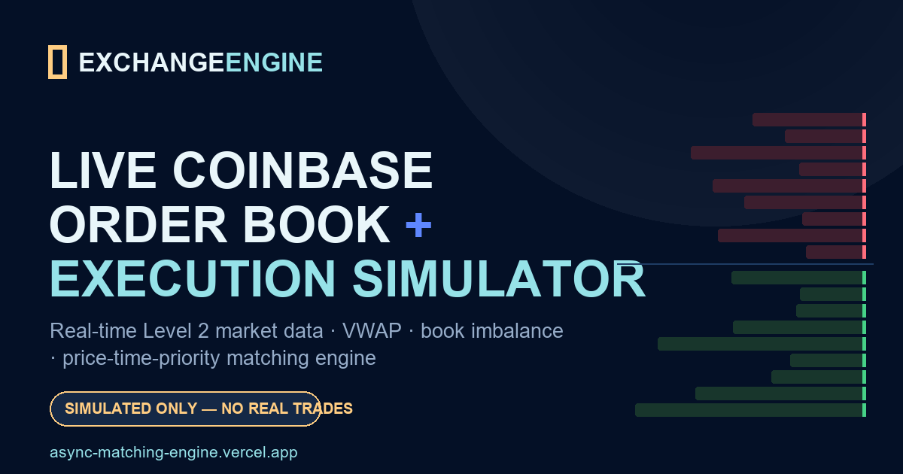
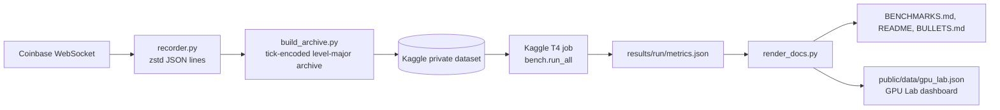

# exchange-engine


Real-time limit order book, matching engine, and microstructure analytics on
**live Coinbase Advanced Trade** market data — no API key or authentication.

**▶ Live demo: https://async-matching-engine.vercel.app/** (streams live BTC &
ETH data straight to your browser; some corporate networks block WebSockets, so
the page offers a clearly-labelled **sample-data** fallback.)



## What it does

Watching a real exchange feed, `exchange-engine` maintains an in-memory
price-time-priority order book, computes liquidity metrics (spread, mid, VWAP,
book imbalance, aggressive-flow imbalance), and lets you estimate how a
hypothetical order would fill against the current book. It ships as a Python
package (the precision implementation) plus a static browser dashboard.

> No real trades are ever placed. The project is public-data-only and
> simulation-only.

## Two implementations, one design

The repo contains a Python engine; the deployed page is a **separate static
browser mirror**. They are intentionally distinct — Vercel serves the static
page and does **not** run the Python engine.

```
Python package (precision)                    Static browser demo (this site)
──────────────────────────                    ───────────────────────────────
Coinbase WS → feed.py → book mirror           Coinbase WS → app.js → per-product
      → metrics.py → Rich dashboard                 book → metrics → DOM
synthetic orders → engine.py (OrderBook)      hypothetical order → core.mjs
      → fills / P&L / FastAPI                        → estimated fills / P&L
```

- **Python** uses `decimal.Decimal` for every price and quantity — exact.
- **Browser** uses IEEE `Number` for its estimates (explicitly labelled as such);
  raw Coinbase strings drive display where identity matters. The Python engine is
  the reference for precision.

## Correctness choices (Coinbase specifics)

- Public endpoint `wss://advanced-trade-ws.coinbase.com`; one subscribe frame
  **per channel** (`level2`, `market_trades`, `heartbeats`).
- Level 2 replies arrive on channel `l2_data`; sides are `bid`/`offer` with
  `offer` mapped to the ask side.
- `new_quantity` is the **absolute** level quantity (not a delta); `0` removes
  the level. Snapshots clear and rebuild the product book.
- `market_trades.side` is the **maker** side. The browser converts it to the
  **aggressor** side for display and flow metrics (aggressive buys green,
  aggressive sells red).
- Heartbeats keep the socket alive and drive feed-health signals; the feed
  reconnects with exponential backoff (2s → 30s).

## Project layout

```
src/exchange_engine/   models · orderbook · feed · engine · dashboard · metrics
                       recorder · archive · reference_engine
tests/                 pytest: orderbook, metrics, engine, feed, models, api, archive,
                       properties (Hypothesis), differential fuzzer, references, docs
tests/frontend/        node:test for the browser core and GPU Lab logic
scripts/               benchmark · replay · record · build_archive · synth_archive ·
                       fuzz_engine · render_docs · check_numbers · check_bullets
cuda/                  CUDA kernels (NVRTC) and the CUB wrapper (nvcc)
cpu/                   C++ baseline for the feature kernels
bench/                 benchmark harness, CPU references, run_all, reproduce
remote/                Kaggle T4 runner, job bodies, Colab fallback
results/               raw results of every remote run (manifests, samples, profiles)
public/                static Vercel dashboard (index.html, css, js/*.mjs, data/)
api/index.py           optional Vercel Python serverless order simulator
```

## Install

```bash
python -m venv .venv && source .venv/bin/activate   # Windows: .venv\Scripts\activate
pip install -e ".[dev]"
```

## Run

```bash
python -m exchange_engine.dashboard                 # Rich terminal dashboard
uvicorn exchange_engine.engine:app --port 8000      # FastAPI service
python -m exchange_engine.engine                    # stdin CLI: "BUY 64000 0.01 LIMIT"
python scripts/replay.py --steps 200                # offline synthetic feed
```

### API

| Method | Path       | Description                                      |
|--------|------------|--------------------------------------------------|
| GET    | `/health`  | Feed liveness + per-product readiness.           |
| POST   | `/order`   | Submit a synthetic order; returns fills + P&L.   |
| GET    | `/book`    | Top-N bid/ask levels from the live feed mirror.  |
| GET    | `/trades`  | Recent trades from the feed.                     |
| GET    | `/metrics` | Spread, mid price, VWAP, imbalance.              |
| GET    | `/analytics` | GPU Lab results (`public/data/gpu_lab.json`).  |

```bash
curl -X POST localhost:8000/order -H 'content-type: application/json' \
  -d '{"side":"buy","price":"64000","quantity":"0.01","order_type":"limit"}'
```

## Tests

```bash
pytest                              # Python suite
node --test tests/frontend/core.test.mjs   # browser core logic
```

CI runs both suites on every push; GPU tests are marked and skipped where `nvidia-smi` is absent.

## Benchmark

```bash
python scripts/benchmark.py --orders 100000 --cancels 10000 --results-dir results/engine-local-<date>
```

Measured on this laptop (`AMD Ryzen 5 7530U with Radeon Graphics`, Python `3.14.7`, `Windows-11-10.0.26300-SP0`), single core, matching path only; raw latencies in [`results/engine-local-20261021`](results/engine-local-20261021):

| Operation | mean | p50 | p95 | p99 |
|---|---:|---:|---:|---:|
| `add_order` (insert + match) | 10.91 µs | 7.70 µs | 23.70 µs | 36.80 µs |
| `cancel_order` | 2.72 µs | 0.60 µs | 8.10 µs | 10.60 µs |

Numbers vary by machine; re-run the command to reproduce on yours. The GPU job runs the same benchmark on its own host CPU (see [BENCHMARKS.md](BENCHMARKS.md)).


## Deploy (Vercel)

`public/` is fully static and connects to Coinbase directly from the browser, so
`vercel deploy` needs no configuration. `api/index.py` is an optional Python
serverless order simulator at `/api/order` (stateless; P&L lives only within a
warm instance).

## Known limitations

- The public demo **never places real orders** — it estimates immediate fills
  against currently-displayed liquidity and does not rest unfilled quantity as a
  live Coinbase order.
- Browser P&L is hypothetical mark-to-market in USD with **fees excluded**.
- Browser math uses IEEE `Number`; the Python package is the exact
  (`Decimal`) implementation.
- The serverless API is stateless, so its P&L does not persist across instances.

## Design decisions & tradeoffs

- **Static-first demo.** A persistent WebSocket can't run in a serverless
  function, so the live dashboard connects from the browser instead of proxying
  through the Python service. This keeps the demo reliable and free, at the cost
  of duplicating a little logic in JS (kept pure and unit-tested in `core.mjs`).
- **Separate feed mirror vs. simulation book.** The feed mirror reflects the
  real market; the engine's `OrderBook` is a distinct instance so synthetic
  orders never mutate the observed book.
- **`SortedDict` + `deque`.** O(log n) level access with FIFO time priority per
  level — simple, fast, and easy to reason about for a portfolio-scale engine.

<!-- gpu-lab:start -->
## GPU analytics layer

An offline layer that replays the recorded Coinbase book on an NVIDIA Tesla T4. Every number below is rendered from committed raw results by `scripts/render_docs.py`; the full set with raw links is in [BENCHMARKS.md](BENCHMARKS.md), the reasoning in [DESIGN.md](DESIGN.md).



Archive: 863,153 book snapshots and 280,818 trades of BTC-USD and ETH-USD, 9.36 hours of capture, 0 sequence gaps.

### The optimization ladder

| Rung | Per-kernel median ms (IQR) | End to end ms | Effective GB/s | % of measured ceiling | % of theoretical | Block | Verified |
|---|---:|---:|---:|---:|---:|---:|:---:|
| v0 array-of-structures, one kernel per metric | 41.9 (IQR 26.3) | 100 | 8.9 | 3.4 | 2.8 | 256 | yes |
| v1 structure-of-arrays, one kernel per metric | 2.02 (IQR 0.0143) | 32.3 | 184.6 | 70.4 | 57.7 | 256 | yes |
| v2 structure-of-arrays, fused | 1.79 (IQR 0.0104) | 32.1 | 209.4 | 79.8 | 65.4 | 256 | yes |
| v3 fused, 128-bit loads | 1.57 (IQR 0.00834) | 31.9 | 238.3 | 90.8 | 74.4 | 256 | yes |
| v4 v3 + grid-stride, best launch configuration | 1.49 (IQR 0.0521) | 31.8 | 251.1 | 95.7 | 78.5 | 128 | yes |
| Triton, fused like v2 (extra rung, best of a small sweep) | 1.76 (IQR 0.0160) | 32.0 | 212.7 | 81.1 | 66.4 | 1,024 | yes |

### Key findings

- The fused, vectorized feature kernel reaches 95.7% of the measured read-bandwidth ceiling and is 23.5 times faster than single-threaded C++ per kernel, but only 2.7 times faster than NumPy once transfers are counted.
- Moving the book levels from array-of-structures to structure-of-arrays order cut total kernel time by 95.8% in the Nsight Systems profiles.
- Rolling windows built from prefix sums cancel: the worst float32 window was off by 3.5e+00 of its value and even float64 reached 1.8e-08, above a tenth of a tick, so production uses a double-double scan.
- The warp-cooperative execution-cost kernel prices 1.78 billion simulated orders per second, 4.6 times the divergent thread-per-order walk.
- Ten-level order flow imbalance has essentially no out-of-sample power for the next second's mid move (R squared -0.0020 for BTC-USD), as expected of a liquid market; it is reported as a description, not a signal.
- Transfers take 94.2% of the pipeline's stage time even with three overlapping streams, so the archive should stay resident on the card and every analysis should run in one residency.
- A hand-written single-pass decoupled look-back scan reaches 149.9 GB/s on 16,777,216 elements, 3.5% behind CUB.
- Sending prices as int16 offsets from the best price moves 24.0% fewer bytes and makes the transfer-bound pipeline 25.1% faster end to end, with bit-identical outputs; a second T4 adds no copy bandwidth: 12.3 GB/s on two cards against 12.1 GB/s on one in this session, while 1 of the 2 other full runs, each in its own Kaggle session reporting the same topology, showed close to double.
- Written in Triton, the fused feature kernel needs 0.96 times the GPU time of the CUDA kernel it mirrors, with bit-identical outputs.
- The C++20 core adds an order in 0.386 microseconds at p99 natively, 73.4 times faster than the Python engine on the same stream in the same process, and matches the reference book on every fuzzed stream. On a stream derived from the recorded book its p99 limit order is 90.6 times faster than the Python engine's.
- 43 of 46 launched kernels reach full theoretical occupancy; the others are listed in BENCHMARKS.md with the resource that limits them.

**The GPU is not in the live matching path.** A PCIe round trip alone takes longer than the engine's matching latency, so the GPU only ever analyses recorded history.

### Limitations

- Kaggle T4 sessions and their four-vCPU host; numbers move with the cards' clocks, which are recorded per block and card.
- Nsight Compute is blocked in Kaggle's container, so there are no per-kernel hardware counters: occupancy is theoretical, from the compiler and the occupancy API, and timelines come from Nsight Systems.
- The archive covers one recording window of two products; the order flow imbalance fit describes that window only.
- The C++20 order book core (`native/`) is checked against the reference book by the differential fuzzer; the Python engine remains the reference implementation.

<!-- gpu-lab:end -->

## License

MIT — see [LICENSE](LICENSE).
